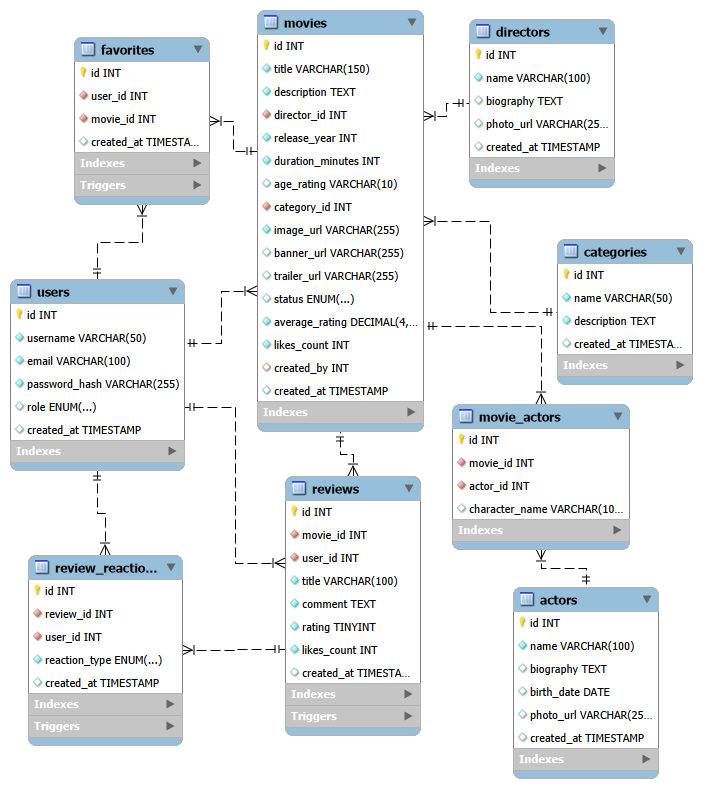

# KarenFlix Backend

API REST para una comunidad geek que cataloga películas, anime y series, administra reseñas y reacciones, y genera rankings. El backend está desarrollado con Node.js y Express; usa MySQL como decisión académica del proyecto y el driver oficial `mysql2` para acceder a la base de datos.

El frontend es un repositorio independiente: [karenflix-frontend](https://github.com/ixenbrandonestiben-lang/karenflix-frontend).

## Tecnologías

- Node.js, Express y JavaScript ES modules.
- MySQL e InnoDB mediante `mysql2/promise`.
- JWT con `jsonwebtoken`, Passport JWT (`passport-jwt`) y contraseñas con `bcrypt`.
- Configuración con `dotenv`; validación de datos con `express-validator`.
- Límites de solicitudes con `express-rate-limit`.
- Documentación OpenAPI/Swagger con `swagger-ui-express`.
- Versionado SemVer validado al iniciar la API.

> MySQL se utiliza por el requisito académico del equipo. No se usa MongoDB ni Mongoose.

## Diagrama de la base de datos



Consulta la [documentación completa del esquema, relaciones e índices](./database/README.md).

## Requisitos

- Node.js 20 o posterior y npm.
- MySQL 8 con InnoDB.
- Acceso al repositorio separado del [frontend](https://github.com/ixenbrandonestiben-lang/karenflix-frontend).

## Instalación y ejecución

1. Clona el repositorio e instala dependencias:

   ```bash
   git clone https://github.com/Anderson-Oloroso/karenflix-backend.git
   cd karenflix-backend
   npm install
   ```

2. Crea la base de datos y ejecuta `database/01-schema.sql`. Para poblarla en desarrollo, ejecuta después `database/02-seeds.sql`. Puedes usar MySQL Workbench o la consola de MySQL.

   El script de seeds contiene credenciales de prueba documentadas en [`database/README.md`](./database/README.md); son solo para desarrollo. No las uses en producción.

3. Crea `.env` a partir de `.env.example` y configura la conexión, el secreto JWT y el origen del frontend. `.env` está excluido de Git:

   ```bash
   cp .env.example .env
   ```

4. Inicia el servidor:

   ```bash
   npm run dev
   ```

   Para ejecutarlo sin Nodemon: `npm start`. La API queda disponible, por defecto, en `http://localhost:4000/api/v1`.

### Variables de entorno

| Variable | Descripción | Valor predeterminado |
| --- | --- | --- |
| `PORT` | Puerto HTTP | `4000` |
| `NODE_ENV` | Entorno de ejecución | Sin valor forzado |
| `API_PREFIX` | Prefijo de rutas | `/api/v1` |
| `DB_HOST` | Host MySQL | Requerida |
| `DB_PORT` | Puerto MySQL | `3306` (el `.env.example` propone `3307`) |
| `DB_USER` | Usuario MySQL de la aplicación | Requerida |
| `DB_PASSWORD` | Contraseña MySQL de la aplicación | Requerida |
| `DB_NAME` | Base de datos | Requerida |
| `DB_CONNECTION_LIMIT` | Conexiones del pool | `10` |
| `JWT_SECRET` | Secreto para firmar/verificar JWT | Requerida; usa un secreto largo y aleatorio |
| `JWT_EXPIRES_IN` | Vigencia del token | `24h` |
| `CORS_ORIGIN` | Orígenes permitidos, separados por comas | GitHub Pages del frontend y puertos locales `5500`, `5173` y `3000` |
| `RATE_LIMIT_WINDOW_MS` | Ventana del límite global en milisegundos | `900000` |
| `RATE_LIMIT_MAX_REQUESTS` | Solicitudes por ventana y cliente | `100` |

El inicio de sesión y el registro tienen un límite adicional de 20 solicitudes cada 15 minutos. `DB_ROOT_PASSWORD` aparece en `.env.example` para configuraciones locales de infraestructura; la aplicación se conecta con `DB_USER` y `DB_PASSWORD`.

## Documentación y ejemplos de API

- Swagger UI: `http://localhost:4000/api-docs`
- OpenAPI JSON: `http://localhost:4000/api-docs.json`
- Prefijo base: `/api/v1` (configurable mediante `API_PREFIX`).

### Rutas principales

| Método | Ruta | Acceso |
| --- | --- | --- |
| `POST` | `/auth/register`, `/auth/login` | Público |
| `POST` | `/auth/logout` | JWT |
| `GET` | `/movies`, `/movies/:id` | Público |
| `POST` | `/movies` | JWT; crea una película pendiente |
| `PUT`, `DELETE` | `/movies/:id` | Administrador |
| `GET` | `/movies/pending` | Administrador |
| `PATCH` | `/movies/:id/approve` | Administrador |
| `GET`, `POST`, `PUT`, `DELETE` | `/categories` y `/categories/:id` | Lectura pública; escritura administrador |
| `GET`, `POST` | `/movies/:id/reviews` | Lectura pública; escritura JWT |
| `PUT`, `DELETE` | `/movies/:id/reviews/:reviewId` | JWT; solo el autor |
| `POST` | `/reviews/:id/reactions` | JWT; no permite reaccionar a la reseña propia |
| `GET`, `POST`, `DELETE` | `/favorites` y `/favorites/:id` | JWT |

Consulta Swagger para ver todos los endpoints, esquemas, validaciones y respuestas documentadas.

### Listar y ordenar películas

```http
GET /api/v1/movies?sort=ranking&category=1&page=1&limit=10
```

`sort` admite `recent`, `popular` y `ranking`. El ranking combina 70% de calificación (ponderada por antigüedad, con vida media de 180 días), 20% de proporción de likes frente al total de reacciones y 10% de actualidad de la reseña más reciente. La respuesta incluye `rankingScore`.

### Crear una película

```http
POST /api/v1/movies
Authorization: Bearer <JWT>
Content-Type: application/json

{
  "title": "Ejemplo geek",
  "description": "Descripción de al menos diez caracteres.",
  "director_id": 1,
  "category_id": 1,
  "release_year": 2024,
  "duration_minutes": 120,
  "image_url": null,
  "trailer_url": "https://www.youtube.com/watch?v=VIDEO_ID"
}
```

`image_url`, `banner_url` y `trailer_url` son opcionales. Las películas nuevas quedan pendientes hasta que un administrador las apruebe. Los títulos duplicados se rechazan.

### Crear una reseña y reaccionar

```http
POST /api/v1/movies/1/reviews
Authorization: Bearer <JWT>
Content-Type: application/json

{
  "title": "Una gran historia",
  "comment": "Comentario de al menos diez caracteres.",
  "rating": 9
}
```

Para dar o alternar una reacción se envía `{"reaction_type":"like"}` o `{"reaction_type":"dislike"}` a `POST /api/v1/reviews/:id/reactions`. Repetir la misma reacción la elimina.

Los errores incluyen `message` y `errors`; también se conservan `mensaje` y `errores` por compatibilidad. Los errores de validación no devuelven los valores enviados.

## Arquitectura

```text
src/
├── config/        # MySQL, Passport, SemVer y Swagger
├── controllers/   # Traducción HTTP y respuestas
├── dtos/          # Formato de salida de la API
├── middlewares/   # Autenticación, CORS, validación, rate limit y errores
├── models/        # Consultas SQL con mysql2
├── routes/        # Enrutamiento de recursos
├── services/      # Reglas de negocio y transacciones
├── utils/         # Errores, logging y utilidades
└── validators/    # Validaciones de entrada
database/
├── 01-schema.sql
├── 02-seeds.sql
└── migrations/
```

Las operaciones críticas de reseñas y reacciones se ejecutan dentro de transacciones InnoDB. Passport JWT vuelve a consultar el estado del usuario y verifica la versión del token, lo que permite revocar sesiones. Los errores HTTP se centralizan en un middleware.


## Principios y consideraciones

- Separación entre rutas, controladores, servicios, modelos y validadores.
- Consultas parametrizadas para los valores recibidos por la API.
- Autorización por roles y verificación de propiedad de reseñas en el backend.
- Contraseñas almacenadas como hashes bcrypt; JWT y secretos configurados mediante variables de entorno.
- Configura `CORS_ORIGIN` con los dominios reales al desplegar. El frontend GitHub Pages usa el origen `https://ixenbrandonestiben-lang.github.io` (sin la ruta del repositorio).
- Ajusta las credenciales de seeds, la clave JWT y los permisos de MySQL antes de exponer un entorno.

## Entrega académica

### Equipo

- Brandon Estiben Ixén Teleguario — Developer.
- Anderson Oloroso García — Developer.


### Seguimiento SCRUM

Tablero del equipo en [Monday.com](https://ixenbrandonestibens-team-squad.monday.com/boards/18437954558).


### Materiales de entrega

- PDF de planeación SCRUM — [SCRUM.pdf](https://drive.google.com/drive/folders/1RAnTXVnz4HJQQlliIRE3cq6Hid5QzcgF?usp=drive_link).


## Créditos

Proyecto académico KarenFlix. Backend: [Anderson-Oloroso/karenflix-backend](https://github.com/Anderson-Oloroso/karenflix-backend). Frontend: [ixenbrandonestiben-lang/karenflix-frontend](https://github.com/ixenbrandonestiben-lang/karenflix-frontend).

