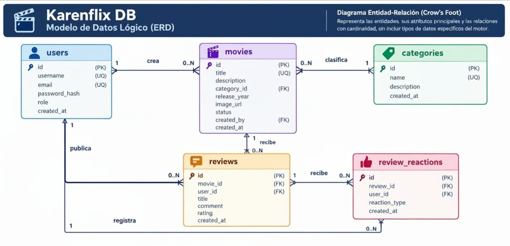
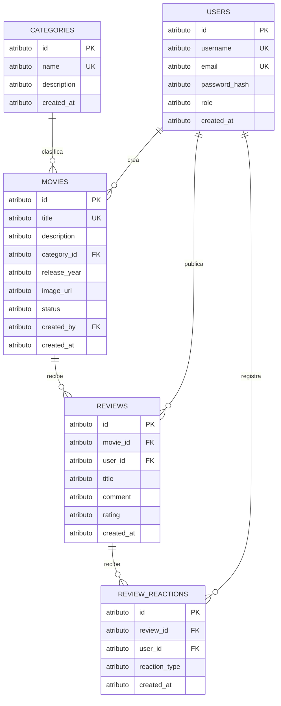

# Base de datos Karenflix

## Propósito

Este documento describe el modelo de datos implementado en `01-schema.sql`, incluyendo sus entidades, relaciones, restricciones e índices. El diagrama ERD se presenta en notación lógica; las definiciones concretas de columnas y restricciones corresponden al esquema MySQL.

El SQL es la fuente de verdad. Si este documento y el esquema difieren, prevalece `01-schema.sql` hasta que ambos se actualicen.

## Objetivos

- Identificar las entidades principales del catálogo y de la interacción de usuarios.
- Expresar las relaciones y sus cardinalidades con notación Crow's Foot.
- Documentar las reglas de integridad, cardinalidades y los índices definidos.
- Mantener una referencia entendible del esquema para quienes desarrollen o mantengan la aplicación.

## Alcance

El esquema cubre usuarios, películas, categorías, reseñas y reacciones a reseñas. Se implementa en MySQL con InnoDB. Este documento refleja el esquema actual y no propone cambios adicionales.

## Diagrama entidad-relación lógico

La imagen original se conserva como referencia visual:

La siguiente versión Mermaid representa las entidades y relaciones implementadas. El tipo `atributo` es un marcador genérico de Mermaid; los tipos concretos están definidos en `01-schema.sql`.

## Entidades y atributos

`PK` identifica una clave primaria; `UK`, una clave única; y `FK`, una clave foránea. Los atributos y restricciones de esta tabla reflejan `01-schema.sql`.

| Entidad | Atributos |
| --- | --- |
| `users` | `id` (PK), `username` (`VARCHAR(50)`, NOT NULL, UK), `email` (`VARCHAR(100)`, NOT NULL, UK), `password_hash` (`VARCHAR(255)`, NOT NULL), `role` (`ENUM('admin', 'user')`, predeterminado `'user'`), `created_at` (`TIMESTAMP`, predeterminado `CURRENT_TIMESTAMP`) |
| `categories` | `id` (PK), `name` (`VARCHAR(50)`, NOT NULL, UK), `description` (`TEXT`, NOT NULL), `created_at` (`TIMESTAMP`, predeterminado `CURRENT_TIMESTAMP`) |
| `movies` | `id` (PK), `title` (`VARCHAR(150)`, NOT NULL, UK), `description` (`TEXT`, NOT NULL), `category_id` (`INT`, NOT NULL, FK), `release_year` (`INT`, NOT NULL), `image_url` (`VARCHAR(255)`, nullable), `status` (`ENUM('pending', 'approved')`, predeterminado `'pending'`), `created_by` (`INT`, NOT NULL, FK), `created_at` (`TIMESTAMP`, predeterminado `CURRENT_TIMESTAMP`) |
| `reviews` | `id` (PK), `movie_id` (`INT`, NOT NULL, FK), `user_id` (`INT`, NOT NULL, FK), `title` (`VARCHAR(100)`, NOT NULL), `comment` (`TEXT`, NOT NULL), `rating` (`TINYINT`, NOT NULL, CHECK entre 1 y 10), `created_at` (`TIMESTAMP`, predeterminado `CURRENT_TIMESTAMP`) |
| `review_reactions` | `id` (PK), `review_id` (`INT`, NOT NULL, FK), `user_id` (`INT`, NOT NULL, FK), `reaction_type` (`ENUM('like', 'dislike')`, NOT NULL), `created_at` (`TIMESTAMP`, predeterminado `CURRENT_TIMESTAMP`), UNIQUE (`review_id`, `user_id`) |

## Relaciones y cardinalidades

En la tabla, el lado “uno” indica que cada registro dependiente se relaciona con un registro padre; `0..N` indica que un padre puede no tener registros dependientes o tener varios.

| Relación | Cardinalidad | Interpretación |
| --- | --- | --- |
| `users` crea `movies` | Un usuario a cero o muchas películas | Cada película se atribuye a un usuario creador. |
| `categories` clasifica `movies` | Una categoría a cero o muchas películas | Cada película pertenece a una categoría. |
| `movies` recibe `reviews` | Una película a cero o muchas reseñas | Cada reseña corresponde a una película. |
| `users` publica `reviews` | Un usuario a cero o muchas reseñas | Cada reseña corresponde a un usuario autor. |
| `reviews` recibe `review_reactions` | Una reseña a cero o muchas reacciones | Cada reacción corresponde a una reseña. |
| `users` registra `review_reactions` | Un usuario a cero o muchas reacciones | Cada reacción corresponde a un usuario. |

## Reglas y restricciones implementadas

Las siguientes reglas están declaradas en `01-schema.sql`:

- `users.username`, `users.email`, `categories.name` y `movies.title` son obligatorios y únicos.
- `review_reactions` impone unicidad compuesta en (`review_id`, `user_id`): un usuario no puede registrar más de una reacción por reseña.
- `users.role` admite `'admin'` o `'user'` y tiene `'user'` como valor predeterminado. La columna no está declarada `NOT NULL`.
- `movies.status` admite `'pending'` o `'approved'` y tiene `'pending'` como valor predeterminado. La columna no está declarada `NOT NULL`.
- `review_reactions.reaction_type` admite `'like'` o `'dislike'` y es obligatorio.
- `reviews.rating` es obligatorio y tiene una restricción `CHECK` de 1 a 10, inclusive.
- Las claves foráneas de `movies`, `reviews` y `review_reactions` especifican `ON DELETE CASCADE`.
- Las claves foráneas y los campos de negocio que las contienen son obligatorios (`NOT NULL`).
- `password_hash` almacena el hash de la contraseña, no la contraseña en texto plano.

## Índices definidos

Esta sección distingue las claves que crean índices para integridad de los índices declarados explícitamente en el script. En MySQL/InnoDB, las claves primarias y las restricciones `UNIQUE` se respaldan con índices. InnoDB también requiere índices en las columnas que participan en claves foráneas y puede crearlos automáticamente cuando el esquema no define uno adecuado.

### Claves primarias y únicas

| Tabla | Columnas | Definición |
| --- | --- | --- |
| `users` | `id` | Clave primaria. |
| `users` | `username` | `UNIQUE`. |
| `users` | `email` | `UNIQUE`. |
| `categories` | `id` | Clave primaria. |
| `categories` | `name` | `UNIQUE`. |
| `movies` | `id` | Clave primaria. |
| `movies` | `title` | `UNIQUE`. |
| `reviews` | `id` | Clave primaria. |
| `review_reactions` | `id` | Clave primaria. |
| `review_reactions` | (`review_id`, `user_id`) | `UNIQUE KEY unique_user_review_reaction`. |

### Índices declarados explícitamente

| Nombre | Tabla | Columnas | Declaración y propósito |
| --- | --- | --- | --- |
| `idx_movies_title` | `movies` | `title` | Índice no único creado explícitamente por el script. Es redundante para la búsqueda por título porque `title` también tiene una restricción `UNIQUE`. |
| `idx_movies_category_status` | `movies` | (`category_id`, `status`) | Índice compuesto para consultas que filtran por categoría y estado; su prefijo también cubre `category_id` para la clave foránea. |
| `idx_reviews_movie_id` | `reviews` | `movie_id` | Índice explícito para localizar reseñas por película y apoyar la clave foránea `reviews.movie_id`. |

No se documentan aquí índices compuestos adicionales como si estuvieran implementados. Los índices internos que MySQL/InnoDB genere para claves foráneas no declaradas con un índice explícito pueden depender de cómo se cree la tabla; el script solo declara los índices explícitos de la tabla anterior.

## Datos iniciales

`02-seeds.sql` agrega dos usuarios de ejemplo, cuatro categorías y dos películas aprobadas. Los datos se insertan usando identificadores de categoría y usuario concretos; por tanto, se asume que las inserciones iniciales mantienen el orden e identificadores esperados por el script.
