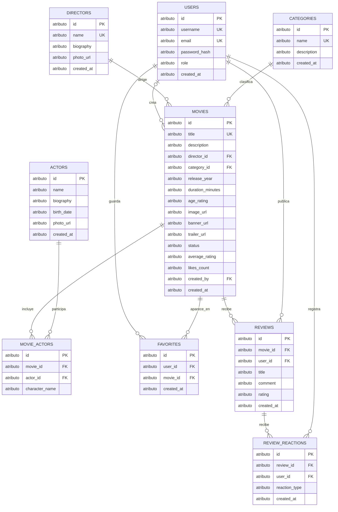

# Base de datos Karenflix

## Propósito

Este documento describe el modelo de datos implementado en `01-schema.sql`, incluyendo sus entidades, relaciones, restricciones e índices. El diagrama ERD se presenta en notación lógica; las definiciones concretas de columnas y restricciones corresponden al esquema MySQL.

El SQL es la fuente de verdad. Si este documento y el esquema difieren, prevalece `01-schema.sql` hasta que ambos se actualicen.

## Objetivos

- Identificar las entidades principales del catálogo y de la interacción de usuarios.
- Expresar las relaciones y sus cardinalidades con notación Crow's Foot.
- Documentar las reglas de integridad, cardinalidades y los índices definidos.
- Mantener una referencia entendible del esquema para quienes desarrollen o mantengan la aplicación.

## Alcance

El esquema cubre usuarios, categorías, directores, películas, actores, la relación entre películas y actores, favoritos, reseñas y reacciones a reseñas. Se implementa en MySQL con InnoDB. Este documento describe las tablas y reglas definidas en `01-schema.sql`.

> **Advertencia:** `01-schema.sql` comienza con `DROP DATABASE IF EXISTS karenflix_db`. Ejecutarlo elimina la base de datos existente y todos sus datos antes de crearla nuevamente. No ejecutes ese script en un entorno con información que quieras conservar.

## Diagrama entidad-relación lógico

La siguiente versión Mermaid representa las entidades y relaciones implementadas. El tipo `atributo` es un marcador genérico de Mermaid; los tipos concretos están definidos en `01-schema.sql`.



## Entidades y atributos

`PK` identifica una clave primaria; `UK`, una clave única; y `FK`, una clave foránea. Los atributos y restricciones de esta tabla reflejan `01-schema.sql`.

| Entidad | Atributos |
| --- | --- |
| `users` | `id` (PK), `username` (`VARCHAR(50)`, NOT NULL, UK), `email` (`VARCHAR(100)`, NOT NULL, UK), `password_hash` (`VARCHAR(255)`, NOT NULL), `role` (`ENUM('admin', 'user')`, predeterminado `'user'`), `created_at` (`TIMESTAMP`, predeterminado `CURRENT_TIMESTAMP`) |
| `categories` | `id` (PK), `name` (`VARCHAR(50)`, NOT NULL, UK), `description` (`TEXT`, NOT NULL), `created_at` (`TIMESTAMP`, predeterminado `CURRENT_TIMESTAMP`) |
| `directors` | `id` (PK), `name` (`VARCHAR(100)`, NOT NULL, UK), `biography` (`TEXT`, nullable), `photo_url` (`VARCHAR(255)`, nullable), `created_at` (`TIMESTAMP`, predeterminado `CURRENT_TIMESTAMP`) |
| `movies` | `id` (PK), `title` (`VARCHAR(150)`, NOT NULL, UK), `description` (`TEXT`, NOT NULL), `director_id` (`INT`, NOT NULL, FK con `ON DELETE RESTRICT`), `category_id` (`INT`, NOT NULL, FK con `ON DELETE RESTRICT`), `release_year` (`INT`, NOT NULL), `duration_minutes` (`INT`, NOT NULL), `age_rating` (`VARCHAR(10)`, predeterminado `'PG-13'`), `image_url` (`VARCHAR(255)`, NOT NULL), `banner_url` y `trailer_url` (`VARCHAR(255)`, nullable), `status` (`ENUM('pending', 'approved', 'rejected')`, predeterminado `'pending'`), `average_rating` (`DECIMAL(4,2)`, NOT NULL, predeterminado `0.00`, calculado por triggers), `likes_count` (`INT`, NOT NULL, predeterminado `0`, total de favoritos actualizado por triggers), `created_by` (`INT`, nullable, FK con `ON DELETE SET NULL`), `created_at` (`TIMESTAMP`, predeterminado `CURRENT_TIMESTAMP`) |
| `actors` | `id` (PK), `name` (`VARCHAR(100)`, NOT NULL), `biography` (`TEXT`, nullable), `birth_date` (`DATE`, nullable), `photo_url` (`VARCHAR(255)`, nullable), `created_at` (`TIMESTAMP`, predeterminado `CURRENT_TIMESTAMP`) |
| `movie_actors` | `id` (PK), `movie_id` (`INT`, NOT NULL, FK), `actor_id` (`INT`, NOT NULL, FK), `character_name` (`VARCHAR(100)`, nullable) |
| `favorites` | `id` (PK), `user_id` (`INT`, NOT NULL, FK), `movie_id` (`INT`, NOT NULL, FK), `created_at` (`TIMESTAMP`, predeterminado `CURRENT_TIMESTAMP`), UNIQUE (`user_id`, `movie_id`) |
| `reviews` | `id` (PK), `movie_id` (`INT`, NOT NULL, FK), `user_id` (`INT`, NOT NULL, FK), `title` (`VARCHAR(100)`, NOT NULL), `comment` (`TEXT`, NOT NULL), `rating` (`TINYINT`, NOT NULL, CHECK entre 1 y 10), `likes_count` (`INT`, NOT NULL, predeterminado `0`, calculado por triggers), `created_at` (`TIMESTAMP`, predeterminado `CURRENT_TIMESTAMP`), UNIQUE (`movie_id`, `user_id`) |
| `review_reactions` | `id` (PK), `review_id` (`INT`, NOT NULL, FK), `user_id` (`INT`, NOT NULL, FK), `reaction_type` (`ENUM('like', 'dislike')`, NOT NULL), `created_at` (`TIMESTAMP`, predeterminado `CURRENT_TIMESTAMP`), UNIQUE (`review_id`, `user_id`) |

## Relaciones y cardinalidades

En la tabla, el lado “uno” indica que cada registro dependiente se relaciona con un registro padre; `0..N` indica que un padre puede no tener registros dependientes o tener varios.

| Relación | Cardinalidad | Interpretación |
| --- | --- | --- |
| `users` crea `movies` | Un usuario a cero o muchas películas; una película puede tener cero o un usuario creador | `movies.created_by` es nullable. Si se elimina al usuario, la película se conserva y el campo queda en `NULL`. |
| `categories` clasifica `movies` | Una categoría a cero o muchas películas | Cada película pertenece a una categoría. |
| `directors` dirige `movies` | Un director a cero o muchas películas | Cada película tiene un director; no se puede eliminar un director asociado (`ON DELETE RESTRICT`). |
| `movies` relaciona `movie_actors` | Una película a cero o muchos registros de reparto | Cada registro de reparto pertenece a una película. |
| `actors` relaciona `movie_actors` | Un actor a cero o muchas películas | `movie_actors` permite asociar varios actores con una película y varias películas con un actor. |
| `users` guarda `favorites` | Un usuario a cero o muchos favoritos | Cada favorito pertenece a un usuario y a una película. |
| `movies` aparece en `favorites` | Una película a cero o muchos favoritos | La combinación usuario-película no se puede repetir. |
| `movies` recibe `reviews` | Una película a cero o muchas reseñas | Cada reseña corresponde a una película. |
| `users` publica `reviews` | Un usuario a cero o muchas reseñas | Cada reseña corresponde a un usuario autor. |
| `reviews` recibe `review_reactions` | Una reseña a cero o muchas reacciones | Cada reacción corresponde a una reseña. |
| `users` registra `review_reactions` | Un usuario a cero o muchas reacciones | Cada reacción corresponde a un usuario. |

## Reglas y restricciones implementadas

Las siguientes reglas están declaradas en `01-schema.sql`:

- `users.username`, `users.email`, `categories.name` y `movies.title` son obligatorios y únicos.
- `users.role` admite `'admin'` o `'user'` y tiene `'user'` como valor predeterminado. La columna no está declarada `NOT NULL`.
- `movies.status` admite `'pending'`, `'approved'` o `'rejected'` y tiene `'pending'` como valor predeterminado. La columna no está declarada `NOT NULL`.
- `movies.likes_count` refleja el total de filas de `favorites` de esa película y se mantiene con procedimientos y triggers.
- `movies.average_rating` admite calificaciones de hasta `10.00`; el procedimiento devuelve `0.00` si todavía no hay reseñas.
- `review_reactions.reaction_type` admite `'like'` o `'dislike'` y es obligatorio.
- `reviews.rating` es obligatorio y tiene una restricción `CHECK` de 1 a 10, inclusive.
- `reviews` impone unicidad compuesta en (`movie_id`, `user_id`): cada usuario puede publicar como máximo una reseña por película.
- Al eliminar un usuario, sus reseñas, reacciones y favoritos se eliminan en cascada; las películas que creó se conservan y su `created_by` queda en `NULL`.
- Al eliminar una reseña, sus reacciones se eliminan en cascada.
- Al eliminar una película, se eliminan en cascada sus reseñas, favoritos y asociaciones con actores (`movie_actors`).
- No se puede eliminar una categoría mientras tenga películas asociadas (`ON DELETE RESTRICT`).
- No se puede eliminar un director mientras tenga películas asociadas (`ON DELETE RESTRICT`).
- Al eliminar un actor, se eliminan en cascada sus asociaciones con películas; no se eliminan las películas.
- `review_reactions` impone unicidad compuesta en (`review_id`, `user_id`): un usuario no puede registrar más de una reacción por reseña.
- Las claves foráneas son obligatorias salvo `movies.created_by`, que admite `NULL` para conservar películas cuando se elimina a su creador.
- `password_hash` almacena el hash de la contraseña, no la contraseña en texto plano.

## Índices definidos

Esta sección distingue las claves que crean índices para integridad de los índices declarados explícitamente en el script. En MySQL/InnoDB, las claves primarias y las restricciones `UNIQUE` se respaldan con índices. InnoDB también requiere índices en las columnas que participan en claves foráneas y puede crearlos automáticamente cuando el esquema no define uno adecuado.

### Claves primarias y únicas

| Tabla | Columnas | Definición |
| --- | --- | --- |
| `users` | `id` | Clave primaria. |
| `users` | `username` | `UNIQUE`. |
| `users` | `email` | `UNIQUE`. |
| `categories` | `id` | Clave primaria. |
| `categories` | `name` | `UNIQUE`. |
| `directors` | `id` | Clave primaria. |
| `directors` | `name` | `UNIQUE`. |
| `movies` | `id` | Clave primaria. |
| `movies` | `title` | `UNIQUE`. |
| `actors` | `id` | Clave primaria. |
| `movie_actors` | `id` | Clave primaria. |
| `favorites` | `id` | Clave primaria. |
| `favorites` | (`user_id`, `movie_id`) | `UNIQUE KEY unique_user_movie_favorite`. |
| `reviews` | `id` | Clave primaria. |
| `reviews` | (`movie_id`, `user_id`) | `UNIQUE KEY unique_movie_user_review`. |
| `review_reactions` | `id` | Clave primaria. |
| `review_reactions` | (`review_id`, `user_id`) | `UNIQUE KEY unique_user_review_reaction`. |

### Índices declarados explícitamente

| Nombre | Tabla | Columnas | Declaración y propósito |
| --- | --- | --- | --- |
| `idx_movies_category_status` | `movies` | (`category_id`, `status`) | Índice compuesto para consultas que filtran por categoría y estado; su prefijo también cubre `category_id` para la clave foránea. |
| `idx_movies_release_year` | `movies` | (`release_year`) | Índice para búsquedas y filtros por año de lanzamiento. |

Las restricciones `UNIQUE` de `movies.title` y `reviews(movie_id, user_id)` también crean índices que apoyan las búsquedas por esas columnas. Los índices internos que MySQL/InnoDB genere para claves foráneas no cubiertas por los índices existentes pueden depender de cómo se cree la tabla.

### Bases de datos existentes

`01-schema.sql` crea una base nueva y comienza eliminando la base `karenflix_db`; no debe ejecutarse sobre una base existente con datos que se quieran conservar. Antes de aplicar la restricción a una instalación existente, identifica y resuelve manualmente cualquier duplicado:

```sql
SELECT movie_id, user_id, COUNT(*) AS total
FROM reviews
GROUP BY movie_id, user_id
HAVING COUNT(*) > 1;
```

Después de resolver duplicados, aplica la migración sin recrear la base:

```sql
ALTER TABLE reviews
ADD CONSTRAINT unique_movie_user_review UNIQUE (movie_id, user_id);
```

## Datos iniciales

`02-seeds.sql` agrega tres usuarios, cuatro categorías, cuatro películas, tres actores, asociaciones de reparto, favoritos, reseñas y reacciones de ejemplo. Las inserciones relacionadas usan identificadores asignados por el orden de inserción; por tanto, el script asume una base de datos vacía recién creada con `01-schema.sql`.

Las contraseñas de los usuarios semilla están almacenadas como hashes bcrypt con coste 10 y pueden usarse para iniciar sesión:

| Usuario | Correo | Contraseña |
| --- | --- | --- |
| `admin_karen` | `admin@karenflix.com` | `KarenflixAdmin2026!` |
| `user_juan` | `juan@gmail.com` | `JuanKflix2026!` |
| `user_maria` | `maria@gmail.com` | `MariaKflix2026!` |

Estas son credenciales públicas de desarrollo. Cámbialas antes de usar los datos semilla en un entorno accesible a terceros o en producción.
